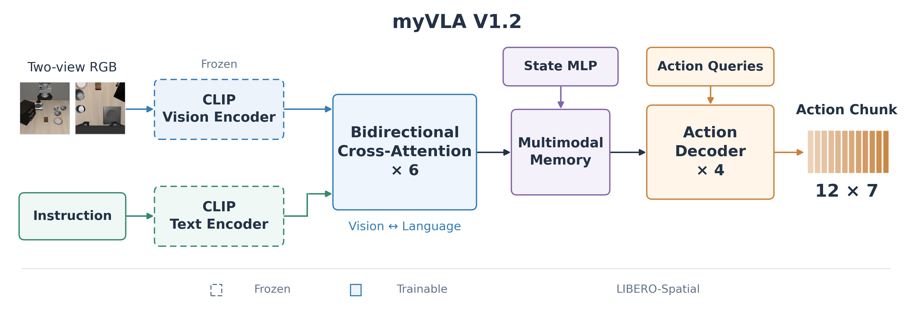

# myVLA

## 一、简介

　　**myVLA 是一个基于 PyTorch 的轻量视觉—语言—动作（VLA）项目**，支持 LIBERO 和 MetaWorld MT50 上的行为克隆训练与闭环评估。模型使用预训练 CLIP 编码图像和语言，通过可训练的动作解码器预测连续动作块。



## 二、安装教程

### 2.1 克隆工程

　　以下命令以 Linux / Bash 环境为例，需要先安装 Git；正式训练还需要 NVIDIA GPU 和可用的驱动。在终端中克隆仓库并进入项目根目录：

```bash
git clone https://github.com/pengxiang-lu/myVLA.git
cd myVLA
```

　　后续安装、下载、训练和评估命令均在此目录执行。已有工程时直接进入对应目录即可；克隆代码不会下载 LIBERO 数据、CLIP 权重或历史 checkpoint，需按后文单独准备。

### 2.2 安装依赖

　　项目使用 `uv` 管理独立虚拟环境。尚未安装时，先按 [uv 官方安装说明](https://docs.astral.sh/uv/getting-started/installation/)执行：

```bash
curl -LsSf https://astral.sh/uv/install.sh | sh
export PATH="$HOME/.local/bin:$PATH"
uv --version
```

　　默认使用 Python 3.10，依赖版本由 `uv.lock` 固定。在项目根目录准备解释器：

```bash
uv python install 3.10
```

​	LIBERO 和 MetaWorld 的 MuJoCo 版本不同，分别使用独立虚拟环境，不能同时启用 `sim` 和 `mt50`。先用下面的 `uv sync` 安装对应依赖，后续统一使用 `uv run 脚本路径`；`UV_PROJECT_ENVIRONMENT` 决定使用哪个虚拟环境。

```bash
# LIBERO 环境：.venv
unset UV_PROJECT_ENVIRONMENT
uv sync --locked --extra sim
uv run scripts/doctor.py

# MetaWorld 环境：.venv-mt50
UV_PROJECT_ENVIRONMENT=.venv-mt50 uv sync --locked --extra mt50
```

### 2.3 准备 CLIP 权重

　　两套环境共用同一份 CLIP 权重。下载脚本支持分段续传及校验，默认保存到 `models/clip-vit-base-patch16/`。

```bash
unset UV_PROJECT_ENVIRONMENT
uv run scripts/download_clip.py --workers 4
```

　　如果运行后出现 curl: (28) Connection timed out after 15000 milliseconds 报错，就用下面命令：

```bash
# 生成镜像版下载脚本
sed 's|https://huggingface.co/|https://hf-mirror.com/|g' \
  scripts/download_clip.py > scripts/download_clip_mirror.py

# 使用项目环境下载
uv run scripts/download_clip_mirror.py --workers 2
```

​	两份配置均通过相对路径 `models/clip-vit-base-patch16` 加载本地权重，因此命令应在项目根目录运行；权重放在其他位置时修改 `model.backbone`。`HF_HUB_OFFLINE=1` 可选，用于禁止联网检查。

​	正式训练需要可用的 CUDA；CPU 调试需同时设置 `train.device: cpu` 和 `train.precision: fp32`。

### 2.4 准备 LIBERO 源码

　　LIBERO 闭环评估需要源码和仿真资源。没有源码时，将官方仓库克隆到默认查找位置；已有源码可跳过克隆，通过 `LIBERO_ROOT` 指定目录。

```bash
git clone https://github.com/Lifelong-Robot-Learning/LIBERO.git third_party/LIBERO
export LIBERO_ROOT="$PWD/third_party/LIBERO"
export MUJOCO_GL=egl
uv run scripts/sim_smoke.py
```

　　本机已有源码可使用 `export LIBERO_ROOT=/home/lpx/python-project/LIBERO`。仿真依赖由本项目管理，无需额外安装上游整份 requirements；仅训练 HDF5 数据时不需要启动模拟器。

## 三、训练

### 3.1 LIBERO 数据准备

```bash
unset UV_PROJECT_ENVIRONMENT
# 下载spatial
uv run scripts/download_data.py \
  --suite libero_spatial \
  --directory data \
  --endpoint https://hf-mirror.com \
  --max-workers 2 
```

​	下载命令的 `--suite` 支持 `libero_spatial`、`libero_object`、`libero_goal`、`libero_10`、`libero_90` 和 `libero_100`。其中 `libero_10` 单独下载 LIBERO-10（Long）；`libero_100` 会同时下载 `libero_90` 和 `libero_10`，并分别保存到对应子目录。

### 3.2 LIBERO 模型训练

　　例如对于v1模型进行训练，可以指定训练步数和输出目录，也可以不指定使用默认参数：

```bash
uv run src/myvla/train.py \
  --config configs/train_cfg_v4.yaml \
  --output-dir outputs/train/libero_spatial_v4
```

V4 在 V2.2 基础上使用 8 层双向交叉注意力融合块，继续训练 CLIP 视觉编码器，文本编码器保持冻结，其余训练设置一致。使用独立配置和输出目录从头训练：

```bash
HF_HUB_OFFLINE=1 .venv/bin/python src/myvla/train.py \
  --config configs/train_cfg_v4.yaml \
  --output-dir outputs/train/libero_spatial_v4
```

### 3.3 MetaWorld MT50 数据准备与训练

　　切换到 MT50 环境，下载官方 LeRobot v3 图像/parquet 数据，并导入为训练使用的 HDF5。完整原始数据约 45.9GB，还需预留转换后的空间；将 `/path/to/datasets` 改为实际下载位置。

```bash
export UV_PROJECT_ENVIRONMENT=.venv-mt50

uv run scripts/download_data.py \
  --suite metaworld_mt50 --directory /path/to/datasets --max-workers 2

uv run scripts/convert_metaworld.py \
  --source /path/to/datasets/metaworld_mt50_raw \
  --output data/metaworld_mt50

uv run scripts/inspect_data.py \
  --dataset metaworld --data-dir data/metaworld_mt50

HF_HUB_OFFLINE=1 uv run src/myvla/train.py \
  --config configs/train_cfg_v1_2.yaml --dataset metaworld
```

　　导入目标目录必须不存在。当前导入器支持 LeRobot v3 内嵌 RGB，不支持旧版 v2 或视频存储。`--dataset metaworld` 自动切换相机数量、状态/动作维度和默认数据目录，各版本均可使用；数据在其他位置时追加 `--data-dir`。上述 V1.2 命令默认训练 30,000 步，输出为 `outputs/train/metaworld_mt50_v1_2`；其输入输出维度与 LIBERO 不同，需要独立训练。

### 3.4 参数设置与断点恢复

　　若要从已有权重开始 EMA 微调，需使用开启 EMA 的配置和 `--init-checkpoint`，并指定新的输出目录；该操作重置优化器和 EMA 更新次数。有 EMA 的初始化 checkpoint 默认使用 EMA 权重作为微调起点。

```bash
# 恢复 LIBERO 训练
unset UV_PROJECT_ENVIRONMENT
HF_HUB_OFFLINE=1 uv run src/myvla/train.py \
  --resume outputs/train/libero_spatial_v2_2/checkpoint_20000.pt

# 恢复 MT50 训练
export UV_PROJECT_ENVIRONMENT=.venv-mt50
HF_HUB_OFFLINE=1 uv run src/myvla/train.py \
  --resume outputs/train/metaworld_mt50_v1_2/checkpoint_30000.pt
```

　	如果需要指定训练终止步数，添加--steps参数。

```bash
# 已完成 20,000 步，再追加 20,000 步；从 checkpoint 保存的步数继续到累计 40,000 步
HF_HUB_OFFLINE=1 uv run src/myvla/train.py \
  --resume outputs/train/libero_spatial_v1_2/checkpoint_20000.pt \
  --steps 40000
```

　　`--init-checkpoint` 用于加载权重开始新的微调，并重置优化器，两者不能同时使用。已有输出目录会被保护，重新训练请设置新的 `--output-dir`。旧 checkpoint 仍可用于推理、初始化或续训；旧配置中的验证字段会被忽略。续训会将原验证轨迹纳入训练，并保留 checkpoint 的归一化统计量、优化器、EMA 和原学习率计划。仅使用 `--resume` 时，保存间隔默认改为 2,000 步；提供 `--config` 时使用配置中的 `save_every`，也可用 `--save-every` 显式指定。旧的 `latest.pt` 仍可作为续训起点，后续按新规则命名。新训练的归一化统计量从全部演示计算。

## 四、评估

　　`evaluate.py` 会根据 checkpoint 自动选择 LIBERO 或 MT50；也可用 `--dataset libero` 或 `--dataset metaworld` 显式核对。查看完整参数使用 `uv run src/myvla/evaluate.py --help`。

### 4.1 LIBERO 闭环评估

```bash
unset UV_PROJECT_ENVIRONMENT
export LIBERO_ROOT=/home/lpx/python-project/LIBERO	# 如果LIBERO放在其他位置

HF_HUB_OFFLINE=1 MUJOCO_GL=egl uv run src/myvla/evaluate.py \
  --checkpoint outputs/train/libero_spatial_v2_2/checkpoint_6000.pt \
  --suite libero_object --episodes 10 --execute-steps 12 \
  --output-dir outputs/eval/libero_object_v2_2
```

　　将 `LIBERO_ROOT` 和 `--checkpoint` 改为实际路径。省略 `--tasks` 会评估整个套件；追加 `--tasks 0` 可仅评估单任务，追加 `--video`（或 `--videos`）保存视频到 `ckpt<步数>/seed<seed>/videos/`。Spatial 默认每任务 10 回合、每回合最多 220 个控制步，默认每次执行完整 12 步预测动作后重新观察；使用旧的 8 步 checkpoint 时，需显式设置 `--execute-steps 8` 或更小的值。

​	由于训练好的权重里面用EMA 权重和原始权重，默认使用EMA权重，如果需要显式指定使用的权重类型可以在脚本后面添加下面参数来指定：

```
--weights ema   # 使用 EMA 权重
--weights raw   # 使用原始权重
```

### 4.2 MetaWorld MT50 闭环评估

```bash
export UV_PROJECT_ENVIRONMENT=.venv-mt50

HF_HUB_OFFLINE=1 MUJOCO_GL=egl uv run src/myvla/evaluate.py \
  --checkpoint outputs/train/metaworld_mt50_v1_2/checkpoint_30000.pt \
  --episodes 50 --execute-steps 1 --protocol lerobot \
  --output-dir outputs/eval/metaworld_mt50_v1_2
```

　　默认评估 50 个任务，每任务 50 回合，每回合最多 500 步。`--protocol lerobot` 使用可复现的随机位置；`--protocol benchmark` 使用 MetaWorld MT50 提供的 goal，每任务最多 50 个。快速检查可追加 `--tasks 0 --episodes 2 --horizon 50`，保存视频使用 `--video`（或 `--videos`）。

　　评估会在每个 episode 完成后原子更新 `progress.json`，按任务名记录从 0 开始的 episode 编号及成功/失败布尔值。中断后使用相同 checkpoint、参数和 `--output-dir` 重新运行，会自动跳过所有已完成回合（包括失败回合），只重跑中断时尚未完成的回合。任务名使用 LIBERO 或 MetaWorld 的实际任务名。全部完成后再次运行会返回汇总，不重复仿真。

输出目录按实验名和 checkpoint 步数组织。例如上述命令生成：

```text
outputs/eval/libero_spatial_v1_1/
└── ckpt10000/
    └── seed42/
        ├── progress.json
        ├── log.json
        ├── episodes.jsonl
        └── videos/
            └── task00_episode000.mp4
```

`--output-dir` 指定实验目录；程序按 checkpoint 的实际步数和 `--seed`（默认 42）创建 `ckpt<步数>/seed<seed>/` 子目录。不同 seed 自动分目录保存，无需修改实验目录名；也可直接传入匹配的 checkpoint 或 seed 目录。启用视频时才在 seed 目录内创建 `videos/`。评估目录保留以下文件：

- `progress.json`：逐任务、逐回合的成功/失败记录，是续跑依据。
- `log.json`：仅在全部回合完成后生成，包含 `success_rate`（各任务成功率）和 `total_success_rate`（各任务成功率的平均值）。
- `episodes.jsonl`：首行是 `type: evaluation_metadata` 的配置和续跑核对记录（checkpoint SHA-256、所选权重、seed 及评估参数等），后续每行是一条 episode 详细记录。不再生成评估用 `config.yaml` 或 `evaluation.json`；旧版评估目录续跑时会将信息迁入该首行，再移除旧文件。
- 可选的 `videos/*.mp4`：各回合的视频。

模型表现由手动闭环评估衡量；比较实验时保持评估协议、seed、回合数及动作执行长度一致。需要从头重测或更换参数时使用新输出目录；旧版未生成 `progress.json` 的评估目录仍受覆盖保护。

### 4.3 推理耗时测试

​	使用 checkpoint 中的模型结构测试 batch=1 的完整动作块推理，无需启动仿真：

```bash
HF_HUB_OFFLINE=1 uv run scripts/measure_inference_time.py \
  --checkpoint outputs/train/libero_spatial_v1/checkpoint_20000.pt \
  --device cuda --precision fp32 \
  --output outputs/benchmark/libero_spatial_v1.json
```

具体测量时间流程是：

1.  使用 **单张 GPU、batch=1**，加载 checkpoint，模型进入评估模式并关闭梯度，报告记录实际 GPU 型号。
2.  提前准备固定的合成图像、状态和分词后的语言输入，并放到 GPU。脚本使用 eager 模式，不启用编译或 CUDA Graph；输入准备和传输不计时。
3.  **预热 10 次**，每次推理后同步 GPU。
4.  正式测量 **50 次**：每次开始前同步 GPU，生成完整动作块后再次同步，再记录耗时。
5.  取 50 次耗时的**中位数**作为延迟，同时报告平均值、P95、最小值、最大值和各次耗时。动作长度从 checkpoint 读取；使用当前 LIBERO 配置新训练的模型时，每次生成 **12 步动作**，旧的 8 步权重仍生成 8 步。

​	计时包含视觉编码、语言编码、融合、动作头及 GPU 上的动作反归一化、夹爪转换和裁剪；不包含模型加载、输入准备和传输、输出拷回 CPU、通信或环境执行。为包含完整语言编码，脚本绕过正常评估的语言缓存，每次重新执行文本编码器。

​	默认使用 FP32；可通过 `--precision fp16` 或 `bf16` 测试混合精度，通过 `--warmup` 和 `--runs` 调整预热与测量次数。输出的每秒动作块预测次数由中位延迟换算，不代表机械臂实际控制频率。

## 附：

​	百度飞桨AI Studio的uv安装：

```bash
pip install uv				
	
alias uv='python -m uv'		
uv --version
```

​	需要把uv run命令换成.venv/bin/python
