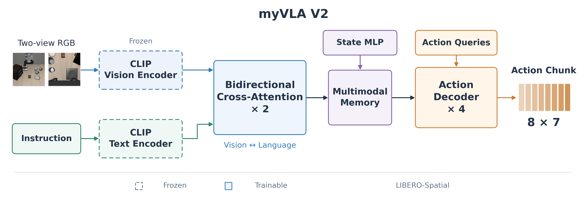

# myVLA

基于 PyTorch 的轻量语言条件动作策略，使用 **uv** 管理独立 `.venv`。

- 双相机 RGB → 冻结 CLIP ViT-B/16 的 patch tokens（保留空间信息）。
- 自然语言 → 冻结的 CLIP 文本编码器，按任务缓存语言特征。
- 8 维本体状态 → 可训练 MLP。
- 4 层、256 隐藏维度的 Transformer decoder → 未来 8 步动作。
- 每步为 6 维末端增量与夹爪；Huber 回归 + 夹爪 BCE；默认执行 4 步再观察。

这是用于建立训练/评测闭环的基线，不是大规模预训练的通用机器人模型。

模型架构、训练参数和 LIBERO-Spatial 历史成功率见 [VLA 模型历史](VLA_HISTORY.md)。

双向融合版 V2 的 LIBERO-Spatial 模型框图（[可编辑 SVG](assets/model_architecture_v2.svg)）：



## 1. 安装与诊断

在项目目录执行；无需激活 conda，也不要复用其他项目环境：

```bash
uv sync --locked
uv run --locked myvla doctor
uv run --locked myvla smoke --output runs/smoke
uv run --locked pytest -q
```

当前机器的验证记录见 [VALIDATION.md](VALIDATION.md)。pytest 已禁用第三方插件自动
加载，避免系统 ROS 的 Python 3.12 插件进入这个 Python 3.10 项目。

Python 固定为 3.10，PyTorch 固定为 2.6.0（Linux x86_64 的 PyPI wheel 含 CUDA
12.4 依赖），Transformers 固定为 4.57.6；完整版本以 `uv.lock` 为准。
软件源使用这台电脑已有缓存对应的阿里云 PyPI 镜像，以复用大型 CUDA wheel。
`uv` 可自动获取 Python；首次安装需要网络和数 GB 空间。建议保留共享 uv 缓存，避免重复下载。

`smoke` 在 CPU 上生成少量合成 HDF5，使用真实但随机初始化的微型 CLIP，执行
训练、验证、checkpoint 保存/重载和前向推理。它不下载 CLIP，也不启动 LIBERO，
其 loss **不代表 LIBERO 表现**。重复运行请换输出目录。

若 `doctor` 显示 CUDA 不可用，先排查系统驱动/设备访问问题；本项目不会安装驱动。
正式配置默认 CUDA + FP16，不会静默退回 CPU。

## 2. LIBERO 源码和数据

训练直接读取原始 LIBERO HDF5，不依赖模拟器。仿真与下载工具另行安装：

```bash
uv sync --locked --extra sim
```

LIBERO 官方安装脚本的旧版依赖与本项目分开管理；不要再安装它的整份 requirements。
上游依赖源码/仿真资源，使用源码目录加载，避免其打包遗漏资源：

```bash
export LIBERO_ROOT=/home/lpx/python-project/LIBERO
```

这台电脑已有上述目录，项目不会修改它。其他机器可将官方仓库 clone 至
`third_party/LIBERO`（默认查找位置），并自行固定 Git commit：

```bash
git clone https://github.com/Lifelong-Robot-Learning/LIBERO.git third_party/LIBERO
git -C third_party/LIBERO rev-parse HEAD
```

程序在项目 `.libero/` 下生成配置，不会初始化或覆盖 `~/.libero`。也支持显式设置
`LIBERO_CONFIG_PATH`；若已有此配置，请确认其中的资源路径有效。

不加载模型，先验证真实仿真环境：

```bash
uv run --locked --extra sim myvla sim-smoke
# 无可用 EGL GPU 时，可在安装了系统 OSMesa 的机器上执行：
uv run --locked --extra sim myvla sim-smoke --gl osmesa
```

下载 Spatial（命令会真正下载数据，首次仅需要这个套件）：

```bash
uv run --locked --extra sim myvla download --suite libero_spatial --directory data
uv run --locked myvla inspect --data-dir data/libero_spatial
```

下载命令会保留已有文件和 `data/.cache/huggingface` 中的续传信息，中断后重跑
同一命令即可。下载本身不需要模拟器；`--libero-root` 保留兼容，但下载时不再使用。
默认同时下载 2 个文件，可用 `--max-workers` 调整。
如果直连 Hugging Face 长时间没有字节进度，可以尝试兼容镜像（第三方服务）：

```bash
HF_HUB_DISABLE_XET=1 HF_HUB_DOWNLOAD_TIMEOUT=60 HF_HUB_ETAG_TIMEOUT=30 \
  uv run --locked myvla download --suite libero_spatial --directory data \
  --endpoint https://hf-mirror.com --max-workers 2
```

此选项不能保证镜像速度；若仍无进度，需要检查本机网络或代理到实际文件存储域名的连接。
不要同时运行多个下载进程写同一个目录，也不要删除续传缓存。

也可直接使用已有数据，将配置中的 `data.directory` 改为相应目录，无需复制。
目录内容应类似：

```text
data/libero_spatial/
  pick_up_the_black_bowl_..._demo.hdf5
```

每个文件要求 `data.attrs['problem_info']` 中有 `language_instruction`，并含多条
`data/demo_N`：

```text
actions                  (T, 7)
obs/agentview_rgb        (T, H, W, 3) uint8
obs/eye_in_hand_rgb      (T, H, W, 3) uint8
obs/ee_states            (T, 6): xyz + axis-angle
obs/gripper_states       (T, 2)
```

也支持用 `ee_pos` + `ee_ori` 代替 `ee_states`。不自动猜测 LeRobot/重编码数据的字段。
动作必须是 LIBERO 相对 OSC_POSE 的 [-1,1] 控制量；负夹爪值为打开，正值为闭合。

默认按每个任务的**完整轨迹**确定性划分 90%/10%，每个任务至少 2 条演示；
状态和前六维动作的统计量只从训练轨迹计算。动作窗口不跨轨迹，尾部用 mask。
图像默认上下翻转、bicubic resize 到 224、使用 CLIP mean/std；仿真复用同一实现。
若数据已预先翻转，请修改 `flip_vertical`，不要沿用原始数据配置。

## 3. 训练

如果 Hugging Face 自动下载权重长期停在 0%，可先从官方固定版本下载到本地。
脚本使用 curl 分段续传，校验配置/分词文件的 Git blob hash 和完整权重的 SHA256；
重跑会复用已完成的分段及匹配 HTTP Range 的部分内容：

```bash
uv run --locked python scripts/download_clip.py --workers 4
```

下载完成后，`models/clip-vit-base-patch16/` 包含完整 CLIP 模型与分词器。
本机可使用 `configs/libero_spatial_local.yaml`（模型路径为本机绝对路径），
换机器时将其中 `model.backbone` 改为该机器的实际模型目录。
设置 `HF_HUB_OFFLINE=1` 可明确要求训练完全使用本地文件：

```bash
HF_HUB_OFFLINE=1 uv run --locked myvla train \
  --config configs/libero_spatial_local.yaml \
  --steps 200 --output-dir runs/spatial_probe
```

```bash
# 先做短跑，观察日志中的 peak_vram_gib 和耗时
uv run --locked myvla train --config configs/libero_spatial.yaml \
  --steps 200 --output-dir runs/spatial_probe

# 正式训练；默认 micro batch=2、累积=8，有效 batch=16
uv run --locked myvla train --config configs/libero_spatial.yaml

# 中断后恢复，自动读取 checkpoint 中的配置
uv run --locked myvla train --resume runs/spatial_v1/latest.pt
```

单任务调试：复制 YAML，把 `data.pattern` 改成一个确切的 `*_demo.hdf5` 文件名，
并设置新的 `train.output_dir`。训练不要求先安装 sim extra。

`steps` 是优化器更新尝试次数，日志记录 AMP 溢出跳过情况。
采样按帧均匀、有放回；自定义 sampler 使恢复后的数据顺序不受 worker 预取影响。
只有策略头加入 AdamW，编码器始终 eval + no_grad。FP16 使用 GradScaler，
支持 BF16/FP32；CPU 调试须同时设置 `device: cpu`、`precision: fp32`。
OOM 时先将 batch_size 改为 1，按需提高梯度累积。

不下载预训练权重，使用相同尺寸的随机 CLIP 架构检查 CUDA/AMP/显存：

```bash
uv run --locked python scripts/profile_cuda.py
```

本机已完成这项探测：双相机 224×224、batch=2、4 层 256 维动作头，
PyTorch 峰值分配约 0.66GiB。此值不含驱动/context 的所有开销，且不是实际数据训练的
速度或成功率；正式训练仍应先短跑检查显存、数据加载和 loss。

训练产物：

- `latest.pt` / `best.pt`：最近/最低离线验证损失的 checkpoint。
- `config.yaml`：解析后的配置，含 CLIP 的固定 Hugging Face commit。
- `manifest.json`：轨迹划分和文件大小/mtime；数据变化时拒绝恢复。
- `stats.json`：训练集统计量。
- `metrics.jsonl`：loss、学习率、梯度范数、验证损失、耗时、显存。

checkpoint 保存策略头、优化器、scheduler、scaler、随机状态和统计量；
真实 CLIP 权重通过固定 commit 引用，不反复写入。评测机器需已有该模型缓存或能联网。
已用完整运行与中断恢复运行对比验证 CPU 参数逐位一致；GPU 的数值确定性不作保证。
恢复不允许改变步数/学习率计划/数据/架构；短跑结束后正式训练请启动新目录。
每次只保留 latest/best，验证损失仅作开发参考，并非成功率或 benchmark 最优 checkpoint。

### 图像增强微调

已有权重可通过 `--init-checkpoint` 开始独立的微调实验：只加载权重，重新创建优化器和
学习率计划。模型结构、数据划分及归一化必须与初始化 checkpoint 一致。
这与恢复完整训练状态的 `--resume` 不同，两者不能同时使用。

```bash
HF_HUB_OFFLINE=1 uv run --locked myvla train \
  --config configs/libero_spatial_aug.yaml \
  --init-checkpoint runs/spatial_v1/best.pt
```

此配置在训练时加入最多 4 像素的平移和 0.1 强度的亮度/对比度扰动，
用 3e-5 学习率微调 3,000 步；micro batch=4、累积=4，有效 batch 仍为 16。
验证和推理不使用增强。增强在主训练进程内执行，其随机状态随 checkpoint 保存和恢复。
`validation_batches=50` 对应 200 个固定验证帧，与原配置的 100×2 保持一致。
输出位于 `runs/spatial_aug_v2`，其中 `initialization.json` 记录初始化权重来源。
微调效果需依据同初始状态、同控制参数的仿真结果确认，不能仅凭 loss 推断成功率。

## 4. 闭环评测

```bash
export LIBERO_ROOT=/home/lpx/python-project/LIBERO
export MUJOCO_GL=egl
uv run --locked --extra sim myvla eval \
  --checkpoint runs/spatial_v1/best.pt \
  --suite libero_spatial --tasks 0 --episodes 5 \
  --execute-steps 4 --output runs/eval_task0 --videos

# 整个 Spatial，省略 --tasks
uv run --locked --extra sim myvla eval \
  --checkpoint runs/spatial_v1/best.pt \
  --suite libero_spatial --episodes 10 --output runs/eval_spatial
```

每次仅运行一个环境；每回合清空动作队列，使用官方初始状态（按 seed 确定性选择且不重复），
先执行 10 个空动作稳定物理，再闭环控制。依据 `env.check_success()` 统计成功，
不以离线动作误差替代成功率。支持 `--device cpu`，但真实 CLIP 推理较慢。
本机已验证 EGL；OSMesa 在本机验证时发生段错误，请使用默认 EGL。
其他机器可用 `sim-smoke --gl osmesa` 单独确认其 OSMesa 后端是否可用。

输出 `episodes.jsonl`、`results.json` 和可选 MP4；记录任务、初始状态索引/校验和、
模型配置、LIBERO 源码位置/commit、seed、步数上限、动作执行长度等。
默认策略控制步数上限：Spatial 220、Object 280、Goal 300、Long 520、90 400；
这是本项目默认评测协议，可用 `--horizon` 修改，比较论文时必须对齐对方协议。
10 次/任务适合开发，正式实验建议更充分采样与多个训练/评测 seed。
本版有 10% 演示留作验证，与使用全部演示训练的论文结果不能直接比较。

## 代码结构

```text
configs/libero_spatial.yaml  本机起步配置
src/myvla/config.py          严格配置
src/myvla/preprocess.py      图像/状态/动作的共享转换
src/myvla/data.py            HDF5、轨迹划分、流式统计与动作 mask
src/myvla/model.py           冻结 CLIP、可训练动作头和损失
src/myvla/train.py           AMP、验证、可恢复训练与 checkpoint
src/myvla/evaluate.py        动作队列与 LIBERO rollout
src/myvla/libero_runtime.py  源码/资源配置与初始状态加载
src/myvla/cli.py             命令行与 CPU smoke
tests/test_pipeline.py      数据泄漏、mask、冻结、转换、恢复和闭环队列测试
scripts/profile_cuda.py     不下载权重的完整尺寸 CUDA/AMP 显存探测
```

参考：[LIBERO 官方仓库](https://github.com/Lifelong-Robot-Learning/LIBERO)、
[CLIP ViT-B/16](https://huggingface.co/openai/clip-vit-base-patch16)。

### 双向视觉—语言融合实验

`model.fusion_layers` 默认为 0，兼容已有 checkpoint。设置为 2 时，保留 CLIP
逐 token 文本特征，在动作解码前加入双向交叉注意力、FFN 和可训练残差门控。
CLIP 仍冻结；融合层与动作头一起训练。文本 padding 不参与视觉对语言的注意力。
门控从零开始，便于从原策略平滑初始化；这不是 TurboVLA 的完整复现。

```bash
HF_HUB_OFFLINE=1 uv run --locked myvla train \
  --config configs/libero_spatial_fusion.yaml \
  --init-checkpoint runs/spatial_aug_v2/best.pt
```

`--init-checkpoint` 允许从 `fusion_layers=0` 扩展到融合模型，其余架构、数据划分和
归一化必须一致；只允许融合模块缺少权重，重置优化器。`--resume` 仍要求架构一致。
`configs/libero_spatial_fusion_control.yaml` 为相同步数、学习率和数据增强的无融合对照。
实验结果使用独立目录，不覆盖已有的 `spatial_aug_v2`。

## MetaWorld MT50：训练与评估

支持官方 [`lerobot/metaworld_mt50`](https://huggingface.co/datasets/lerobot/metaworld_mt50)
当前的 **LeRobot v3、parquet 内嵌 RGB** 格式。原始输入为单相机 480×480 RGB、
4 维机器人状态（末端 xyz + 夹爪开度）、4 维连续动作（xyz + 夹爪）。
训练时使用自然语言任务描述，不把物体/目标位置等 39 维特权状态输入模型。
动作头和融合层可训练，CLIP 冻结；夹爪也使用连续 Smooth-L1 损失。
这是监督式行为克隆，没有实现 MetaWorld 在线强化学习算法。

### 安装独立环境

MetaWorld 3.0 / MuJoCo 3.3 与 LIBERO 的 MuJoCo 2.3.7 不兼容，两个 extra 不能同时启用。
使用单独虚拟环境，保留原 `.venv`：

```bash
export UV_PROJECT_ENVIRONMENT=.venv-mt50
uv sync --locked --extra mt50
```

下面命令均在项目根目录、保留上述环境变量时执行。切回 LIBERO 时执行
`unset UV_PROJECT_ENVIRONMENT`，并使用 `--extra sim`。

### 下载、导入与训练

完整原始数据当前为 492 个数据分片，合计约 **45.9GB**，另需导入后 HDF5 的空间。
可以把原始数据下载到其他磁盘；本次代码验证只下载了第一个分片，没有下载全量数据。

```bash
uv run --locked --extra mt50 myvla download \
  --suite metaworld_mt50 --directory /path/to/datasets --max-workers 2
# 网络需要时可追加 --endpoint https://hf-mirror.com

uv run --locked --extra mt50 myvla convert-metaworld \
  --source /path/to/datasets/metaworld_mt50_raw \
  --output data/metaworld_mt50

uv run --locked --extra mt50 myvla inspect \
  --dataset metaworld --data-dir data/metaworld_mt50

HF_HUB_OFFLINE=1 uv run --locked --extra mt50 myvla train \
  --config configs/metaworld_mt50.yaml
```

配置引用本机 `models/clip-vit-base-patch16`；其他机器需修改 `model.backbone`。
默认训练 30,000 步、batch=4、累积=4、2 层交互。MT50 与 LIBERO 的状态、相机和输出
维度不同，应使用本配置开始新训练，不能直接恢复 LIBERO 动作头。
中断后按原配置恢复：

```bash
HF_HUB_OFFLINE=1 uv run --locked --extra mt50 myvla train \
  --resume runs/metaworld_mt50_v1/latest.pt
```

导入按 task_id 保留 50 个任务身份，不依赖 parquet 分片边界划分演示。
每个任务需要至少两条完整轨迹；默认全量导入核对 2,500 条轨迹、204,806 帧及全部 50 个任务。
图像使用 bicubic 缩至 224×224，不再翻转；数据中的 RGB 已经过相机方向修正。
专家 xyz 动作可能超过 [-1,1]，导入时裁剪到实际控制范围，并在 conversion.json 记录次数。
训练按任务将整条演示划分为训练/验证集，统计量只从训练轨迹计算。

如果只想开发调试，可显式使用 `--tasks 0 1` 或 `--max-episodes 2` 导入子集；
同一轨迹跨分片时会继续读取直到完整。输出目录必须不存在，成功前只写临时目录。
子集会标记 `full_mt50=false`，不能当作完整 MT50 训练。已有 HDF5 输出不会被覆盖。
暂不支持旧版 LeRobot v2、视频存储或第三方 npz/pkl 数据，不能只改文件后缀导入。

### 闭环评估

```bash
HF_HUB_OFFLINE=1 MUJOCO_GL=egl uv run --locked --extra mt50 myvla eval-metaworld \
  --checkpoint runs/metaworld_mt50_v1/best.pt \
  --output runs/eval_metaworld_mt50 \
  --episodes 50 --execute-steps 1
```

默认全部 50 任务 × 50 回合，单回合最多 500 步。
按任意一步 `info["success"]` 为真计成功，不用 reward 代替成功率。
`--tasks 0 1` 可评估部分任务，`--episodes 2 --horizon 50` 可快速检查，
`--videos` 保存 RGB MP4；每回合重置动作队列。

提供两种明确记录的评估协议：

- `--protocol lerobot`（默认）：匹配 LeRobot MT50 RGB wrapper 的相机和随机位置设置；
  MT1(seed=42) 初始化，每回合使用独立、可复现的环境 seed。
- `--protocol benchmark`：MetaWorld MT50(seed) 提供的每任务 50 个 goal，按固定随机排列
  逐个评估；回合数不得超过 50。输出记录 goal index 和 goal 数据 SHA256。

两种协议都使用 corner2、相机位置 [0.75, 0.075, 0.7]、480×480 渲染及双轴翻转，
与导入数据保持 RGB 方向一致，后续 resize/归一化与训练共享。
MetaWorld 3.0 的 reset(seed=...) 会忽略 seed，因此额外调用 env.seed()。
`execute_steps=1` 表示预测动作块后只执行第一步再观察，可修改为不超过 chunk_size 的值。

输出 `episodes.jsonl` 和 `results.json`，包含逐任务成功率、回合种子、评估协议、
相机参数、模型配置、训练任务覆盖数与依赖版本；拒绝覆盖已有评估结果。
中断时保留已完成任务的摘要，并标记 `completed=false`。
不同协议、训练目标分布和执行动作长度的分数不能直接比较；本视觉模仿学习设置
也不等同于原始使用状态/任务 one-hot 的 MT50 强化学习评测。

新增实现：`metaworld_data.py`、`metaworld_evaluate.py`、`metaworld_tasks.json`；
核心训练器复用原有 AMP、梯度累积、日志、best/latest checkpoint 和断点恢复。
任务 ID 映射依据 LeRobot Apache-2.0 配置，自然语言指令按官方 MT50 数据元信息核对。
