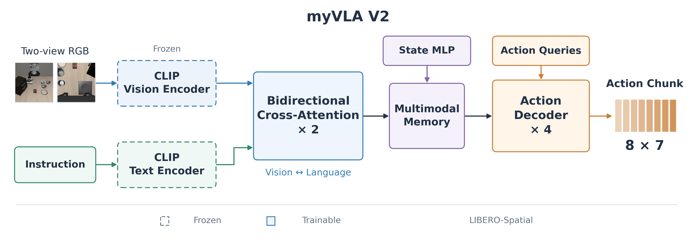
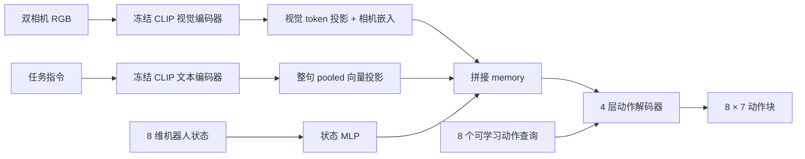
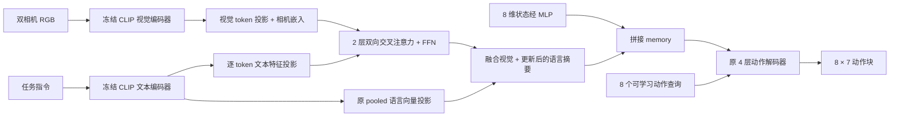

# myVLA 模型历史

更新日期：2026-11-05（Asia/Shanghai）。

本项目目前有两种已在 `libero_spatial` 上评估的模型架构：**V1 基础架构**与
**V2 双向融合架构**。本文的 V1/V2 指架构版本；运行目录中的 `spatial_v1`、
`spatial_aug_v2`、`spatial_fusion_v3` 是训练实验名称，两者不一一对应。
数据增强微调和继续训练对照均属于 V1，没有改变模型架构。

## 1. 版本概览

| 项目 | V1：冻结 CLIP + 动作解码器 | V2：增加双向视觉—语言融合 |
|---|---|---|
| 视觉编码器 | CLIP ViT-B/16，冻结 | 相同，冻结 |
| 文本编码器 | CLIP 文本编码器，冻结 | 相同，冻结 |
| 文本特征 | 整句 pooled 向量 | pooled 向量 + 逐 token 特征、padding mask |
| 解码前视觉—语言交互 | 无，投影后拼接 | 2 层双向交叉注意力及 FFN |
| 动作解码器 | 4 层 Transformer Decoder | 相同 |
| 隐藏维度 / 注意力头数 | 256 / 8 | 256 / 8 |
| 总参数量 | 154,237,704，约 0.154B | 157,396,752，约 0.157B |
| 可训练参数量 | 4,616,967，约 462 万 | 7,776,015，约 778 万 |
| 代表权重 | `runs/spatial_aug_v2/best.pt` | `runs/spatial_fusion_v3/best.pt` |
| LIBERO-Spatial 成功率 | **82%（82/100）** | **84%（84/100）** |

V1 的同训练量继续训练对照为 **83%**。因此 V2 相对代表 V1 权重净增 2 个成功回合，
相对继续训练对照净增 1 个成功回合，尚不足以确认稳定的架构收益。

参数量包含加载到模型中的全部 CLIP 参数，其中部分 CLIP 投影参数未用于策略前向。
冻结参数共 149,620,737；V2 新增的 3,159,048 个参数全部属于可训练融合模块。

## 2. 模型架构

下图为 V2 的 LIBERO-Spatial 配置；[SVG 矢量原图](assets/model_architecture_v2.svg)
保留可编辑文字。使用 `scripts/draw_architecture.py` 可重新生成图片。



### 共同输入与输出

- 输入：两路 224×224 RGB（外部相机、腕部相机）、自然语言指令、8 维机器人状态。
- 状态：末端 xyz（3）+ 姿态轴角（3）+ 两个夹爪关节位置（2）。
- 图像：共享冻结 CLIP 编码，每路保留 196 个 patch token，去掉 CLS token。
- 动作：每次预测 8 步动作块，每步 7 维（6 维末端运动 + 夹爪）。
- 动作头：4 层、256 维、8 头，FFN 维度 1,024，Dropout=0.1。
- 训练：更新动作头；V2 还更新融合模块，CLIP 始终冻结。

### V1：拼接特征后预测动作



V1 已在动作解码器内部使用交叉注意力：动作查询关注视觉、语言和状态 memory。
视觉与语言 memory 在进入动作解码器前没有显式的双向融合。

### V2：解码前增加双向融合



每层包含视觉关注文本、文本关注视觉两个方向，以及各自的 FFN；文本 padding 不参与
视觉对文本的注意力。每层四个 tanh 残差门控从零初始化，使加载 V1 权重后的初始
eval 输出与原模型一致。最终把文本 EOS token 的融合增量加回原 pooled 语言特征。

V2 借鉴轻量视觉—语言交互思路，仍使用 CLIP；没有复现 TurboVLA 的 DINOv3、BERT
或 grounding 预训练融合权重。

## 3. 训练历史与主要参数

所有实验均为单卡 CUDA/FP16、AdamW，梯度范数裁剪 1.0，seed=42，
学习率采用线性 warmup 后余弦衰减。有效 batch 始终为 16。
`steps` 是参数更新步数，不是 epoch；训练帧有放回随机采样。

| 实验 | 架构 | 初始化来源 | 本轮总步数 | 被评估权重步数 | batch × 累积 | 学习率 | 权重衰减 | warmup |
|---|---|---|---:|---|---|---:|---:|---:|
| 初始训练 `spatial_v1` | V1 | 预训练 CLIP，动作头随机初始化 | 30,000 | best=9,000；latest=30,000 | 2 × 8 | 1e-4 | 1e-4 | 500 |
| 增强微调 `spatial_aug_v2` | V1 | `spatial_v1/best.pt` | 3,000 | best=2,500 | 4 × 4 | 3e-5 | 1e-3 | 100 |
| 继续训练对照 `spatial_fusion_control` | V1 | `spatial_aug_v2/best.pt` | 3,000 | best=2,500 | 4 × 4 | 3e-5 | 1e-3 | 100 |
| 双向融合 `spatial_fusion_v3` | V2 | `spatial_aug_v2/best.pt`，新增融合参数 | 3,000 | best=3,000 | 4 × 4 | 3e-5 | 1e-3 | 100 |

初始化关系：

```text
spatial_v1（训练 30,000 步，选第 9,000 步）
└── spatial_aug_v2（微调 3,000 步，选第 2,500 步）
    ├── spatial_fusion_control（继续训练 3,000 步，选第 2,500 步）
    └── spatial_fusion_v3（增加融合后训练 3,000 步，选第 3,000 步）
```

各微调实验通过 `--init-checkpoint` 加载权重，重置优化器和学习率计划；没有接着初始
训练的第 30,000 步继续。表中的步数均为各自训练轮次的局部步数。

其他训练设置：

| 参数 | 初始训练 | 增强微调 / 继续训练对照 / 双向融合 |
|---|---|---|
| 数据增强 | 无 | 随机平移最多 4 像素；亮度/对比度扰动 0.1 |
| 验证间隔 | 每 500 步 | 每 500 步 |
| checkpoint 选择用验证集 | 固定 100 batch × 2 = 200 帧 | 固定 50 batch × 4 = 200 帧 |
| latest 保存间隔 | 每 1,000 步 | 每 500 步 |
| 日志间隔 | 每 20 步 | 每 20 步 |
| DataLoader workers | 2 | 2 |
| 损失 | 6 维运动 Smooth-L1 + 夹爪 BCE-with-logits，屏蔽动作块尾部补齐位置 | 相同 |

所有图像方向修正、状态/动作归一化在离线训练和在线推理之间共享。
增强只在训练期间应用，不做会改变指令空间语义的随机翻转或旋转。

## 4. LIBERO-Spatial 验证与成功率

### 数据与协议

- 训练数据：`data/libero_spatial`，10 个任务，每任务 50 条演示，共 500 条。
- 每任务按整条演示划分约 90% 训练、10% 验证，seed=42，避免同一轨迹跨集合。
- 训练帧 56,026，验证帧 6,224；归一化统计量仅来自训练轨迹。
- 训练中的 best 权重按固定 200 帧验证 loss 选择；下表另报告完整 6,224 帧验证结果。
- 闭环评估：10 个任务 × 每任务 10 回合，共 100 回合，seed=42。
- 每回合先执行 10 步稳定物理；控制步数上限 220；预测 8 步动作，每次执行前 4 步后重新观察。
- 根据 `env.check_success()` 计成功。对比使用相同初始状态索引和状态文件校验和。

### 历史结果

| 实验权重 | 架构 | 成功回合 / 总回合 | 成功率 | 完整验证集 loss |
|---|---|---:|---:|---:|
| 初始 `spatial_v1/best.pt`，第 9,000 步 | V1 | 67/100 | 67% | 0.277981 |
| 初始 `spatial_v1/latest.pt`，第 30,000 步 | V1 | 70/100 | 70% | 0.328802 |
| 增强 `spatial_aug_v2/best.pt`，第 2,500 步 | V1 | 82/100 | **82%** | 0.261862 |
| 对照 `spatial_fusion_control/best.pt`，第 2,500 步 | V1 | 83/100 | 83% | 0.264945 |
| 融合 `spatial_fusion_v3/best.pt`，第 3,000 步 | V2 | 84/100 | **84%** | 0.260624 |

### 两版代表权重逐任务对照

每项均为 10 回合；任务 ID 使用本项目 LIBERO-Spatial `task_order_index=0` 的顺序。

| 任务 ID | V1 增强权重 | V1 继续训练对照 | V2 融合权重 |
|---|---:|---:|---:|
| 0 | 10/10 | 10/10 | 10/10 |
| 1 | 9/10 | 5/10 | 6/10 |
| 2 | 8/10 | 9/10 | 9/10 |
| 3 | 7/10 | 8/10 | 9/10 |
| 4 | 7/10 | 9/10 | 9/10 |
| 5 | 5/10 | 5/10 | 5/10 |
| 6 | 10/10 | 10/10 | 9/10 |
| 7 | 10/10 | 10/10 | 10/10 |
| 8 | 10/10 | 10/10 | 9/10 |
| 9 | 6/10 | 7/10 | 8/10 |
| 合计 | **82/100** | **83/100** | **84/100** |

这些是同一开发评测集上的单次训练结果，尚未做独立评估 seed 或多训练 seed 确认。
V2 相对 V1 增强权重有 9 回合从失败变成功、7 回合从成功变失败；部分任务仍有退步。
以上分数只覆盖 LIBERO-Spatial，不能当作全部 LIBERO 套件的平均成功率。

## 5. 配置、权重与原始记录

| 阶段 | 配置 | 权重 | 仿真结果 JSON |
|---|---|---|---|
| 初始训练 | `configs/libero_spatial_local.yaml` | `runs/spatial_v1/best.pt`、`latest.pt` | `runs/eval_spatial/results.json`；`runs/optimize/latest_full/results.json` |
| V1 增强 | `configs/libero_spatial_aug.yaml` | `runs/spatial_aug_v2/best.pt` | `runs/optimize/aug_full/results.json` |
| V1 对照 | `configs/libero_spatial_fusion_control.yaml` | `runs/spatial_fusion_control/best.pt` | `runs/optimize/fusion_control_full/results.json` |
| V2 融合 | `configs/libero_spatial_fusion.yaml` | `runs/spatial_fusion_v3/best.pt` | `runs/optimize/fusion_full/results.json` |

运行目录保留 `config.yaml`、`metrics.jsonl`、`manifest.json`、`stats.json`；微调另有
`initialization.json`，记录初始化来源。复查历史时以运行时配置和原始结果为准。

更多细节见 [增强优化记录](OPTIMIZATION.md)、[融合实验记录](FUSION_EXPERIMENT.md)。
完整验证结果分别保存在 `runs/optimize/full_validation.json` 和
`runs/optimize/fusion_validation.json`。

## 6. 后续接入记录

2026-11-05：新增 MetaWorld MT50 数据导入、训练和评估接口，以及单相机、4 维状态、
4 维连续动作的配置。已完成小规模真实数据和模拟器接入验证，尚未完整训练 MT50；
因此这里不把它列为第三个已验证的 LIBERO 模型版本。
接入检查见 [MetaWorld 验证记录](METAWORLD_VALIDATION.md)。

后续模型更新时，应新增架构差异、初始化链、训练配置、被评估 checkpoint 步数和
相同评估协议下的结果；在新套件或不同协议上得到的分数单独记录。
