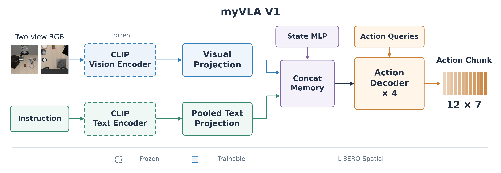
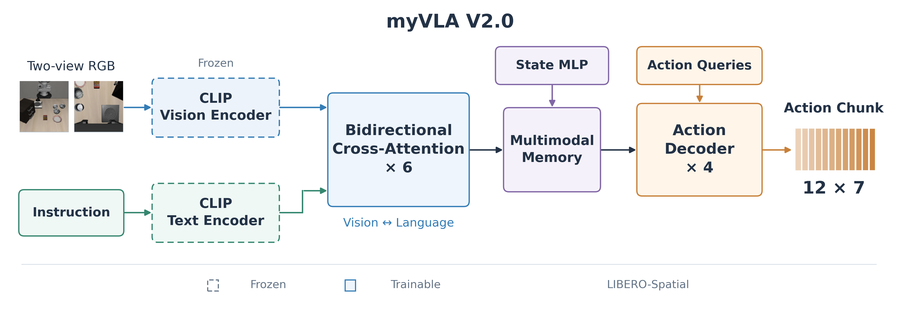
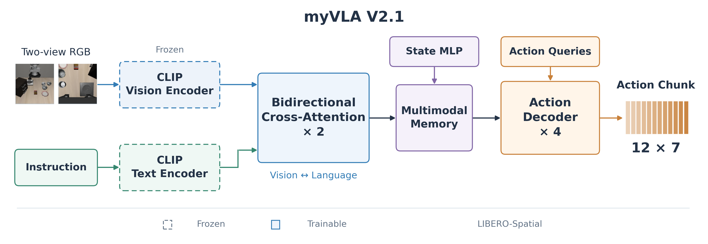

# myVLA 模型历史

## VLA雏形：

- 输入：224×224 双相机 RGB 图像、任务语言、8 维机器人状态。
- 视觉编码器：预训练 CLIP ViT-B/16，V1/V2 冻结，V3 参与训练。
- 文本编码器：CLIP 文本编码器，所有版本均保持冻结。
- 输出：当前各版本训练配置均为 `chunk_size: 12`，输出 12×7 动作块。
- 损失函数：前 6 维 Smooth L1，夹爪 BCE；排除轨迹尾部 padding。

## 第一版 VLA：冻结 CLIP + 动作解码器

​	两个 CLIP 编码器均冻结，无双向融合层；投影后的视觉特征、整句语言向量和状态构成 memory，由 4 层动作解码器预测 12 步动作。

- 配置：`configs/train_cfg_v1.yaml`。
- 总参数量：**154,238,728**（约 **0.154B**）。
- 可训练参数：**4,617,991**（约 **4.62M**，占 **2.99%**）。
- 冻结参数：**149,620,737**。
- 一套 FP32 完整权重：约 **588.37 MiB**。

| 参数分布 | 参数量 | 占总量 | 训练状态 |
|---|---:|---:|---|
| CLIP 视觉编码器 | 85,799,424 | 55.63% | 冻结 |
| CLIP 语言编码器 | 63,165,952 | 40.95% | 冻结 |
| CLIP 原始投影层及温度参数 | 655,361 | 0.42% | 冻结，前向未使用 |
| 视觉特征投影 | 198,400 | 0.13% | 训练 |
| 语言特征投影 | 131,328 | 0.09% | 训练 |
| 状态 MLP | 68,096 | 0.04% | 训练 |
| 双向融合模块 | 0 | 0.00% | 无 |
| 动作解码器（4 层，含末尾 LayerNorm） | 4,214,272 | 2.73% | 训练 |
| 动作输出线性层 | 1,799 | <0.01% | 训练 |
| 动作查询、相机嵌入及模态嵌入 | 4,096 | <0.01% | 训练 |
| **合计** | **154,238,728** | **100%** | |

## 第二版 VLA：双向视觉—语言融合

V2 分为 V2.0（6 层）和 V2.1（2 层），均指双向交叉注意力融合块的层数。

### V2.0：6 层交叉注意力

​	两个 CLIP 编码器均冻结，增加 6 层双向视觉—语言融合；融合层与动作头一起训练，4 层动作解码器预测 12 步动作。

- 配置：`configs/train_cfg_v2.yaml`（保留原文件名，对应 V2.0）。
- 输出目录：`outputs/train/libero_spatial_v2`（保留原目录名）。
- 总参数量：**163,715,872**（约 **0.164B**）。
- 可训练参数：**14,095,135**（约 **14.10M**，占 **8.61%**）。
- 冻结参数：**149,620,737**。
- 一套 FP32 完整权重：约 **624.53 MiB**。

| 参数分布 | 参数量 | 占总量 | 训练状态 |
|---|---:|---:|---|
| CLIP 视觉编码器 | 85,799,424 | 52.41% | 冻结 |
| CLIP 语言编码器 | 63,165,952 | 38.58% | 冻结 |
| CLIP 原始投影层及温度参数 | 655,361 | 0.40% | 冻结，前向未使用 |
| 视觉特征投影 | 198,400 | 0.12% | 训练 |
| 语言特征投影 | 131,328 | 0.08% | 训练 |
| 状态 MLP | 68,096 | 0.04% | 训练 |
| 双向融合模块（6 层） | 9,477,144 | 5.79% | 训练 |
| 动作解码器（4 层，含末尾 LayerNorm） | 4,214,272 | 2.57% | 训练 |
| 动作输出线性层 | 1,799 | <0.01% | 训练 |
| 动作查询、相机嵌入及模态嵌入 | 4,096 | <0.01% | 训练 |
| **合计** | **163,715,872** | **100%** | |

### V2.1：2 层交叉注意力

在 V2.0 的基础上，将双向交叉注意力融合块由 6 层减为 2 层。两个 CLIP 编码器仍冻结，动作解码器仍为 4 层，预测长度仍为 12 步。其余训练参数与 V2.0 一致，使用独立输出目录。

- 配置：`configs/train_cfg_v2_1.yaml`。
- 输出目录：`outputs/train/libero_spatial_v2_1`。
- 总参数量：**157,397,776**（约 **0.157B**）。
- 可训练参数：**7,777,039**（约 **7.78M**，占 **4.94%**）。
- 冻结参数：**149,620,737**。
- 一套 FP32 完整权重：约 **600.42 MiB**。

| 参数分布 | 参数量 | 占总量 | 训练状态 |
|---|---:|---:|---|
| CLIP 视觉编码器 | 85,799,424 | 54.51% | 冻结 |
| CLIP 语言编码器 | 63,165,952 | 40.13% | 冻结 |
| CLIP 原始投影层及温度参数 | 655,361 | 0.42% | 冻结，前向未使用 |
| 视觉特征投影 | 198,400 | 0.13% | 训练 |
| 语言特征投影 | 131,328 | 0.08% | 训练 |
| 状态 MLP | 68,096 | 0.04% | 训练 |
| 双向融合模块（2 层） | 3,159,048 | 2.01% | 训练 |
| 动作解码器（4 层，含末尾 LayerNorm） | 4,214,272 | 2.68% | 训练 |
| 动作输出线性层 | 1,799 | <0.01% | 训练 |
| 动作查询、相机嵌入及模态嵌入 | 4,096 | <0.01% | 训练 |
| **合计** | **157,397,776** | **100%** | |

## 第三版 VLA：视觉编码器联合训练

沿用 V2.1 的 2 层双向融合与 4 层动作解码器，解冻视觉编码器，语言编码器保持冻结。输出为 12×7，与 V2.1 的参数总量相同，区别在于训练范围。

- 配置：`configs/train_cfg_v3.yaml`。
- 总参数量：**157,397,776**（约 **0.157B**）。
- 可训练参数：**93,576,463**（约 **93.58M**，占 **59.45%**）。
- 冻结参数：**63,821,313**。
- 一套 FP32 完整权重：约 **600.42 MiB**。

| 参数分布 | 参数量 | 占总量 | 训练状态 |
|---|---:|---:|---|
| CLIP 视觉编码器 | 85,799,424 | 54.51% | 训练 |
| CLIP 语言编码器 | 63,165,952 | 40.13% | 冻结 |
| CLIP 原始投影层及温度参数 | 655,361 | 0.42% | 冻结，前向未使用 |
| 视觉特征投影 | 198,400 | 0.13% | 训练 |
| 语言特征投影 | 131,328 | 0.08% | 训练 |
| 状态 MLP | 68,096 | 0.04% | 训练 |
| 双向融合模块（2 层） | 3,159,048 | 2.01% | 训练 |
| 动作解码器（4 层，含末尾 LayerNorm） | 4,214,272 | 2.68% | 训练 |
| 动作输出线性层 | 1,799 | <0.01% | 训练 |
| 动作查询、相机嵌入及模态嵌入 | 4,096 | <0.01% | 训练 |
| **合计** | **157,397,776** | **100%** | |

## 验证成功率：

以下为当前已保存评估结果在 **LIBERO-Spatial** 上的闭环成功率。列头为 checkpoint 的实际训练步数；“—”表示暂无评估结果。模型版本依据结果文件中的架构与 checkpoint 路径判定，不仅依据输出目录名。

已保存的原 V2 评估均为 6 层融合，归入 V2.0；V2.1 暂无评估结果。

共同设置：EMA 权重，seed=42，10 个任务×每任务 10 回合，共 100 回合；每回合最多 220 个控制步，先执行 10 步稳定物理。预测长度均为 12 步，按实际动作执行长度分表记录。

### 每次执行 4 步

| 模型 | 3,500 步 | 4,000 步 | 10,000 步 |
|---|---:|---:|---:|
| V1 | — | [67%](outputs/eval/libero_spatial_v1/results.json) | [77%](outputs/eval/libero_spatial_v1_latest/results.json) |
| V2.0 | [66%](outputs/eval/libero_spatial_v2/results.json) | — | [68%](outputs/eval/libero_spatial_v2_latest/results.json) |
| V2.1 | — | — | — |
| V3 | — | — | — |

### 每次执行 12 步

| 模型 | 11,000 步 | 12,000 步 |
|---|---:|---:|
| V1 | [79%](outputs/eval/libero_spatial_v1_12/results.json) | — |
| V2.0 | — | [73%](outputs/eval/libero_spatial_v2_12/results.json) |
| V2.1 | — | — |
| V3 | — | — |

4 步执行表中，V1 的 4,000 步、V2.0 的 3,500 步来自各自的 `best.pt`，两组 10,000 步来自当时的 `latest.pt`。12 步执行表中，V1 使用 11,000 步的 `latest.pt`，V2.0 使用 12,000 步的 `latest.pt`。

V2.0 的 12 步执行结果已核对为 `outputs/train/libero_spatial_v2/latest.pt`、`fusion_layers: 6`，100 回合成功 73 次；该结果文件已被新的 V2 评估替换，先前同目录中的 V1 80% 记录不再列入表格。

两张表使用了不同训练步数的 checkpoint，不能仅凭成功率差异判断将执行长度从 4 改为 12 的收益；需要同一份 checkpoint 的配对评估。
